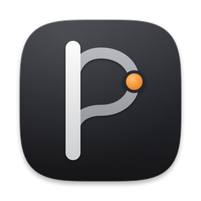
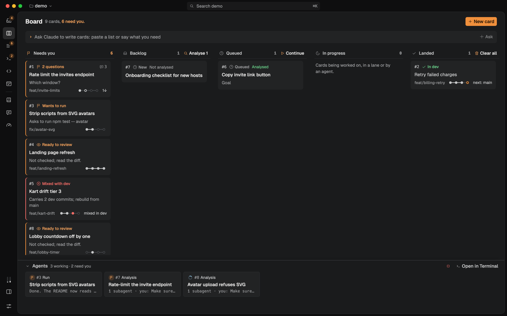
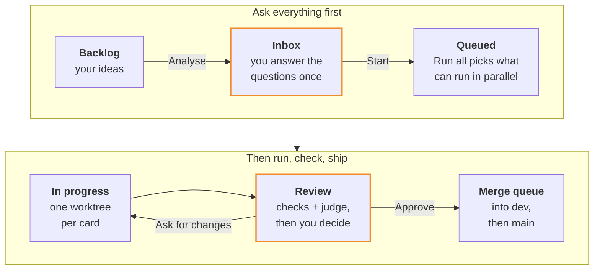
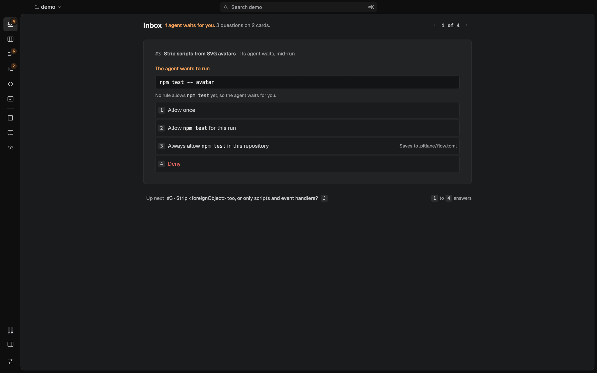
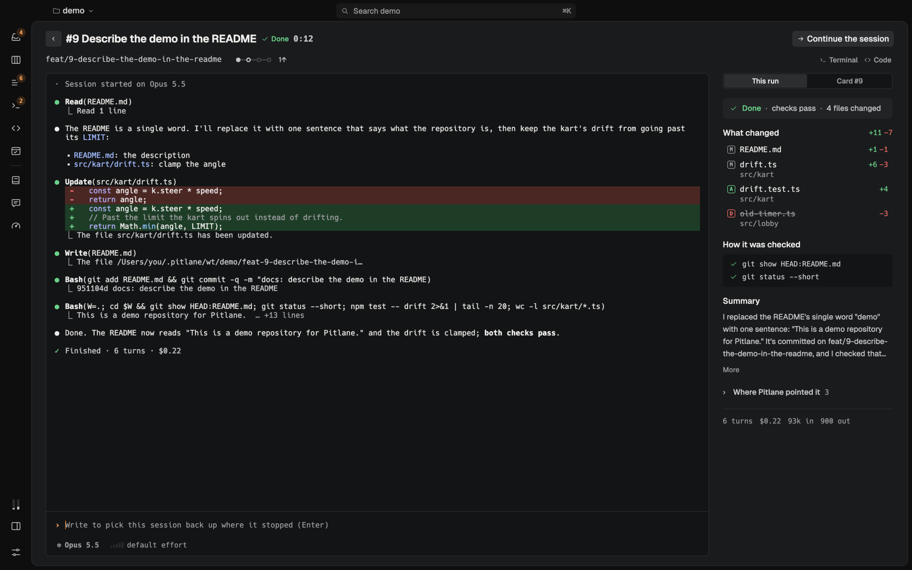
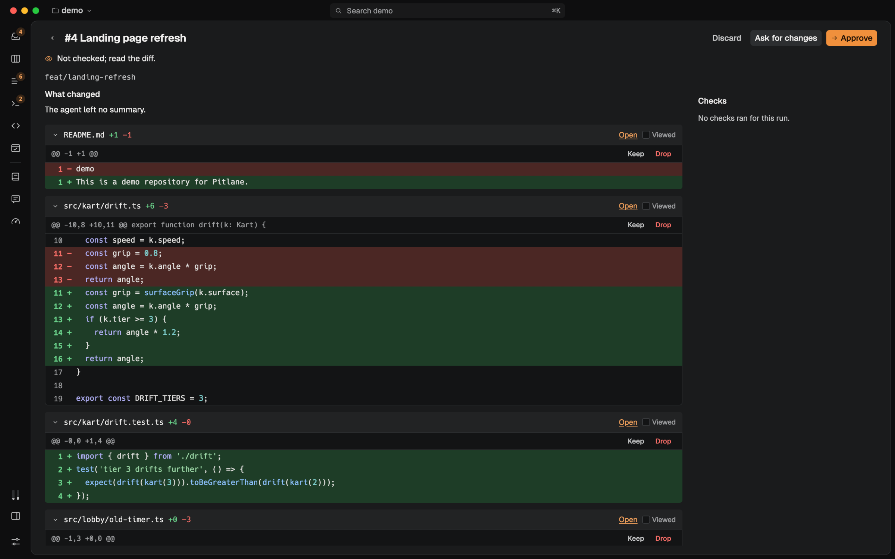
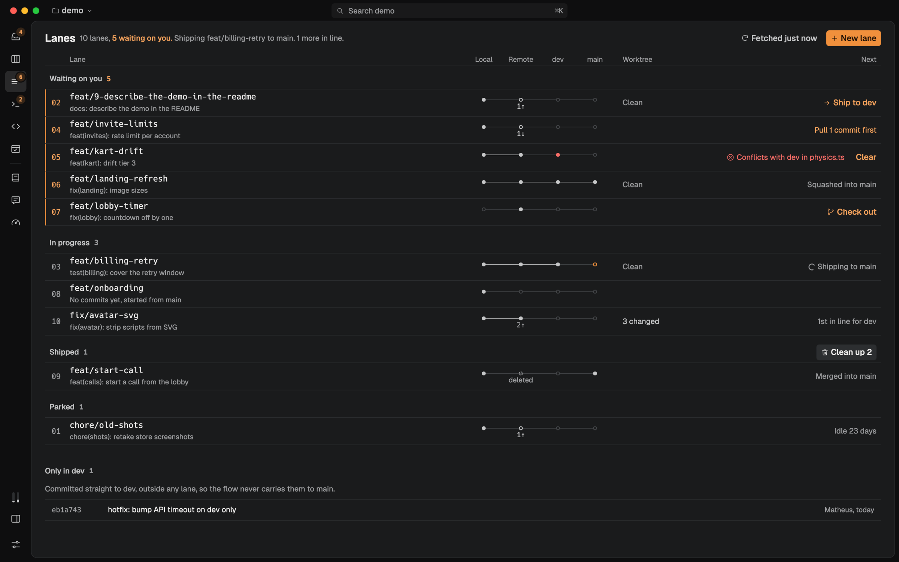
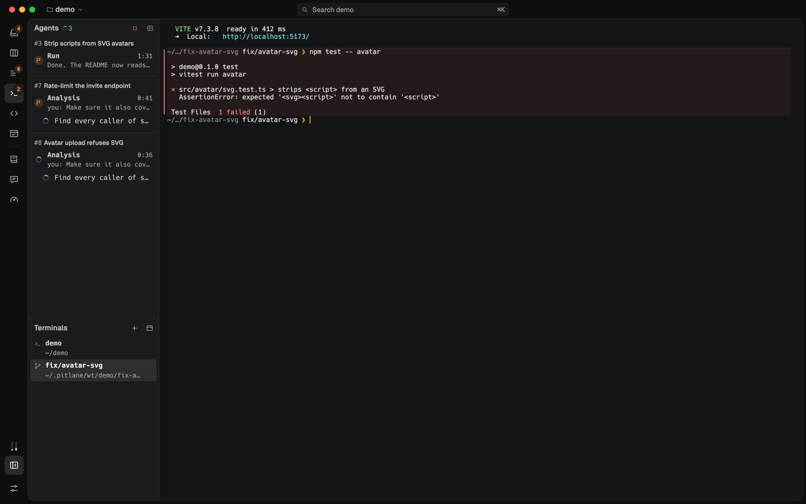
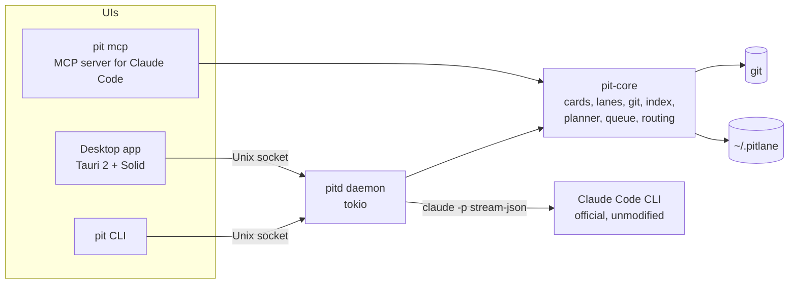

<p align="center">
  
</p>

<h1 align="center">Pitlane</h1>

<p align="center">
  <strong>A local desktop app for running Claude Code agents: terminal, editor and kanban in one window.</strong>
</p>

<p align="center">
  <a href="LICENSE"></a>
  
  
  
</p>

<p align="center">
  <a href="#getting-started">Getting started</a> ·
  <a href="#tour">Tour</a> ·
  <a href="#cli-reference">CLI</a> ·
  <a href="#contributing">Contributing</a>
</p>

<picture>
  <source media="(prefers-color-scheme: dark)" srcset=".github/assets/board-dark.webp">
  <source media="(prefers-color-scheme: light)" srcset=".github/assets/board-light.webp">
  
</picture>

You write cards on a board. Pitlane asks you every question about them up front, gives each card its own branch and worktree, runs Claude Code on it, has the work checked, and merges it through a queue. Every agent it starts shows up live, and you can stop any of them.

> [!NOTE]
> **Pre-release (v0.0.1).** macOS on Apple Silicon only for now. The [first release](https://github.com/matheussartori/pitlane/releases/latest) is an unsigned build, or you can build it from source. This first version supports Claude Code only. Support for other agents, Codex and Antigravity first, and for Linux and Windows is coming once the macOS version is stable; it still has rough edges.

## Contents

- [How it works](#how-it-works)
- [Tour](#tour)
- [Features](#features)
- [Architecture](#architecture)
- [Requirements](#requirements)
- [Getting started](#getting-started)
- [Configuration](#configuration)
- [CLI reference](#cli-reference)
- [Where Pitlane keeps data](#where-pitlane-keeps-data)
- [Development](#development)
- [Project layout](#project-layout)
- [Design principles](#design-principles)
- [Roadmap](#roadmap)
- [Contributing](#contributing)
- [License](#license)

## How it works



<sub>Orange marks the two steps that wait for you.</sub>

1. **Cards.** Add work to the Backlog from the board, the CLI (`pit card add`), the editor (select code and press ⌘L), or Claude Code itself through the `pitlane` MCP server.
2. **Questions first.** *Analyse* opens one read-only session per card. It writes notes, finds dependencies between cards, and sends its questions to the Inbox. Each answer becomes a numbered project decision that every later run reads.
3. **Run all.** Cards move to *Queued*. Pitlane starts every card it can run in parallel, holds back cards that touch the same area or wait on another card, and starts the rest as earlier work lands.
4. **Runs.** Each card runs in its own worktree on a branch cut from a freshly fetched `origin/main`. The agent gets a briefing that lists the files to look at, built from a tree-sitter index.
5. **Verification.** When a run finishes, your check commands run and a separate read-only Claude session judges the diff against the spec. You approve, ask for changes (the same session continues) or discard.
6. **Shipping.** Approved lanes go through a merge queue into `dev`, then into `main`. Merges are done with git plumbing, so your checkouts are never touched. When the card is finished, its agent session closes.

## Tour

**Inbox.** Questions from the analysis and agents waiting for a permission, one at a time. Keys 1–9 answer, Enter takes the recommended option.

<picture>
  <source media="(prefers-color-scheme: dark)" srcset=".github/assets/inbox-dark.webp">
  <source media="(prefers-color-scheme: light)" srcset=".github/assets/inbox-light.webp">
  
</picture>

**A run.** Every agent session, live, in Claude Code's own style: tool calls, diffs, and what changed and how it was checked on the side. Write to it without stopping it.

<picture>
  <source media="(prefers-color-scheme: dark)" srcset=".github/assets/run-dark.webp">
  <source media="(prefers-color-scheme: light)" srcset=".github/assets/run-light.webp">
  
</picture>

**Review.** The diff of a finished card, file by file, with Keep and Drop per hunk. Approve ships it, Ask for changes continues the same session.

<picture>
  <source media="(prefers-color-scheme: dark)" srcset=".github/assets/review-dark.webp">
  <source media="(prefers-color-scheme: light)" srcset=".github/assets/review-light.webp">
  
</picture>

**Lanes.** Every branch and worktree, its sync with the remote, and whether it has really landed in `dev` and `main`.

<picture>
  <source media="(prefers-color-scheme: dark)" srcset=".github/assets/lanes-dark.webp">
  <source media="(prefers-color-scheme: light)" srcset=".github/assets/lanes-light.webp">
  
</picture>

**Terminal.** Real shells in tabs and split panes, next to every agent session.

<picture>
  <source media="(prefers-color-scheme: dark)" srcset=".github/assets/terminal-dark.webp">
  <source media="(prefers-color-scheme: light)" srcset=".github/assets/terminal-light.webp">
  
</picture>

## Features

| Screen | Key | What it does |
| --- | --- | --- |
| **Inbox** | ⌥1 | Open questions and agents waiting for approval. Answer with 1–9, or Enter for the recommended option. |
| **Board** | ⌥2 | Needs you, Backlog, Queued, In progress, Landed. Drag to reorder, dictate specs, Run all, and an *Ask Claude* bar. |
| **Lanes** | ⌥3 | Every branch and worktree, its sync with the remote, and whether it has really landed in `dev`/`main` (by ancestry, patch-id or PR). Ship and clean in bulk, with undo. |
| **Terminal** | ⌥4 | Real PTY shells in split panes and tabs, plus every agent session shown live in Claude Code's style. |
| **Code** | ⌥5 | VS Code (bundled code-server) opened on the repo or on a lane's worktree. |
| **Preview** | ⌥6 | A lane's dev server inside the app. The URL is detected from terminal output. |
| **Ledger** | ⌥7 | Runs, accounts, models, tokens and cost. |
| **Reports** | ⌥8 | The report written at the end of each Run all batch, exportable to PDF. |
| **Performance** | ⌥9 | Resource use of the daemon and its agents. |

Also included:

- **Approvals in the app.** Agent permission prompts come to Pitlane. You can allow once, for the rest of the run, or always (saved to `flow.toml`), or deny with a reason.
- **Accounts and routing.** Use several Claude profiles and switch between them yourself. When a model hits its usage limit, the run can fall back to another model or to an API key, and the API key always asks you first.
- **On-device dictation.** Whisper large-v3-turbo runs locally with Metal. Audio never leaves the machine.
- **Nothing runs after you close the app.** Quitting stops every agent and shell and pauses the merge queue.

## Architecture



- **`pitd`** owns everything that lives for a while: agent processes and their process groups, the merge queue, sessions and quotas. The CLI and the app start it when they need it, and it stops when the app closes.
- **`pit-core`** contains all the logic and has no UI. It runs git through the `git` CLI (not libgit2), so it behaves exactly like the git you use.
- **Agents** are launched through the official Claude Code CLI (`claude -p --input-format stream-json --output-format stream-json`), with a session ID chosen by Pitlane, permission prompts routed to Pitlane, and a structured handoff schema.

### Account rules (non-negotiable)

- Pitlane never reads, copies, stores or proxies login tokens, and never uses a subscription login through an SDK. You sign in with `claude auth login`, and API keys stay behind your own `apiKeyHelper`.
- Pitlane never switches between two accounts of the same provider automatically. It only falls back automatically to another model, another provider, or an API key.

## Requirements

- macOS on Apple Silicon (dictation uses Metal; the release build is Apple Silicon only)
- `git` 2.38 or newer (needed for `merge-tree --write-tree`)
- [Claude Code](https://docs.claude.com/claude-code) installed and signed in (`claude auth login`)
- Optional: `gh`, to detect merged PRs
- To build from source: [Rust](https://rustup.rs) 1.90 or newer (edition 2024), and Node.js 20.19 or newer with npm

> If rustup was installed with Homebrew, it is keg-only. Add `/opt/homebrew/opt/rustup/bin` to your `PATH`.

## Getting started

### From a release

Download the `.dmg` from [Releases](https://github.com/matheussartori/pitlane/releases/latest) (Apple Silicon) and drag Pitlane to Applications. The build is not signed or notarized yet, so macOS blocks it as downloaded from the internet. Clear that flag once:

```bash
xattr -dr com.apple.quarantine /Applications/Pitlane.app
```

The app bundles the `pit` CLI. Put it on your `PATH`:

```bash
sudo mkdir -p /usr/local/bin && sudo ln -sf /Applications/Pitlane.app/Contents/MacOS/pit /usr/local/bin/pit
```

### From source

```bash
git clone https://github.com/matheussartori/pitlane.git
cd pitlane

# CLI (the Claude Code MCP server uses this binary too)
cargo install --path crates/pit

# Desktop app, in development
cd apps/desktop
npm install
npx tauri dev
```

The first `tauri dev` downloads the pinned code-server and the Whisper model (about 550 MB) into `src-tauri/resources/`.

### Set up a repository

In each repository, write the branch flow and connect Claude Code:

```bash
cd ~/code/your-repo
pit init                              # writes .pitlane/flow.toml and turns on git rerere
claude mcp add pitlane -- pit mcp     # lets Claude Code create and update cards
```

### Release build

```bash
cd apps/desktop
npx tauri build
# → target/release/bundle/macos/Pitlane.app and a .dmg
```

The bundle includes the `pit` sidecar, code-server and the Whisper model. It is not signed or notarized yet, so it runs without a Gatekeeper warning only on the machine that built it.

## Configuration

| File | Scope | Purpose |
| --- | --- | --- |
| `.pitlane/flow.toml` | per repo, committed | Branch flow, worktree setup, checks, judge, agent tools and permission mode |
| `~/.pitlane/routing.toml` | per machine | Accounts, model preferences and fallback route |

A trimmed `flow.toml` (`pit init` writes the full template with comments):

```toml
[flow]
base        = "main"   # new branches always start from a freshly fetched origin/main
integration = "dev"    # "" if there is no integration stage
production  = "main"
forbid      = [{ merge = "dev", into = "main" }]

[worktree]
copy       = [".env"]
clone_deps = ["node_modules"]   # copy-on-write clones
setup      = "npm install --prefer-offline"

[verify]
commands   = ["npm test", "npm run lint"]
judge      = true
max_rounds = 3

[run]
allow           = ["Bash(npm test:*)"]
permission_mode = "auto"
sandbox         = true
brief           = true
```

## CLI reference

`pit --help` lists everything. The main commands:

| Area | Commands |
| --- | --- |
| Lanes | `pit lanes`, `pit new <branch> [--card N]`, `pit ship [--to main]`, `pit clean [--dry-run \| --undo]` |
| Cards | `pit card add \| list \| show \| move \| ask \| answer \| link` |
| Runs | `pit run <card>`, `pit runs`, `pit log <run> -f`, `pit say`, `pit stop`, `pit resume`, `pit continue` |
| Approvals | `pit approvals`, `pit allow <run> [--run-wide \| --always]`, `pit deny <run> -m "…"` |
| Review | `pit review \| approve \| changes -m "…" \| discard <card>` |
| Merge queue | `pit queue`, `pit enqueue <branch> [--to main]`, `pit dequeue <id>` |
| Planning | `pit index`, `pit brief <card>`, `pit plan` |
| Accounts | `pit accounts`, `pit account add \| login \| use` |
| Plumbing | `pit daemon`, `pit mcp` |

## Where Pitlane keeps data

Pitlane does not write anything into your repository except `.pitlane/flow.toml`.

```
~/.pitlane/
├── boards/<repo-key>/   cards (*.md, TOML front matter), decisions.md, deleted/
├── runs/<id>/           meta, raw events, timeline, briefing, handoff, verify.json
├── wt/<repo>/<branch>/  worktrees
├── index/               tree-sitter symbol index
├── reports/             Run all reports
├── queue.json           merge queue (survives restarts)
├── routing.toml         accounts and model route
├── trash.jsonl          what `pit clean` removed (undo for 30 days)
└── pitd.sock            daemon socket
```

The board key is the normalized remote URL. Moving the folder or cloning the repo again keeps the same board.

## Development

```bash
npm install                        # once, at the repository root: installs the commit-msg hook
cargo test                         # workspace tests (temporary git repos)
cargo clippy --workspace           # keep it clean
cd apps/desktop && npm run build   # type-check and bundle the UI

# UI only, in a browser, with fixture data
cd apps/desktop && npm run dev     # add ?state=loading|empty|error
```

Conventions:

- Don't run `cargo fmt`. The repository is not rustfmt-formatted, and running it rewrites dozens of files.
- UI text is in English. Every string goes through `t()`, and translations live in `apps/desktop/src/locales/`.
- UI work follows the locked design system in [`design/design.md`](design/design.md).
- Commit messages follow [Conventional Commits](https://www.conventionalcommits.org) (`type(scope): subject`, then an optional prose body). commitlint checks every message in the `commit-msg` hook and rejects the commit when it doesn't match.

## Project layout

```
crates/
  pit-core/        all logic: cards, lanes, git, flow, index, brief, plan, queue, accounts, verify
  pitd/            daemon: run supervisor, sessions, presence, performance
  pit/             CLI, TUI helpers and the MCP server
apps/desktop/
  src/             Solid UI (one file per screen)
  src-tauri/       Tauri backend: PTY, dictation, code-server, preview, daemon client
  scripts/         fetch code-server and Whisper, build the pit sidecar
  vscode-bridge/   bundled VS Code extension (⌘L "Ask Claude about this")
design/            design system: tokens, base and component CSS, specimen
tools/bench/       replay benchmark for the briefing
tools/screenshots.sh  retakes the README screenshots in .github/assets
```

## Design principles

- **A pit wall.** Every lane is visible, and only the ones that need you light up. Orange means "your turn" and nothing else.
- **Local first.** No account, no server, telemetry only if you opt in.
- **Official CLIs only.** Agents are the unmodified Claude Code CLI, using your own login.
- **Visible and stoppable.** Every session Pitlane starts can be watched and stopped, and nothing runs after the app closes.
- **Ask once.** All questions come before the work starts, and then Run all does not stop to ask again.

## Roadmap

- A stable macOS version. It still has known issues, and they come first.
- Signed and notarized macOS builds.
- Other agents: Codex (`codex app-server`) and Antigravity first, then more.
- Linux and Windows.

The new agents and platforms start once the macOS version is stable.

## Contributing

Contributions are welcome. In short:

1. For anything bigger than a small fix, [open an issue](../../issues/new/choose) first so we can agree on the approach.
2. Fork, branch, run `npm install` at the root once, and keep `cargo test`, `cargo clippy --workspace` and `npm run build` passing. Don't run `cargo fmt`.
3. Write [Conventional Commits](https://www.conventionalcommits.org) messages; the `commit-msg` hook checks them.
4. Open a pull request that says what changes for the user.

[CONTRIBUTING.md](CONTRIBUTING.md) has the details. Please follow the [code of conduct](CODE_OF_CONDUCT.md), and report security issues privately as described in [SECURITY.md](SECURITY.md).

## Documentation

- [`design/design.md`](design/design.md) and [`design/index.html`](design/index.html): design system and live specimen.
- [`CONTRIBUTING.md`](CONTRIBUTING.md): how to contribute and the rules every change keeps.

## Acknowledgements

Pitlane stands on [Claude Code](https://github.com/anthropics/claude-code), [Tauri](https://tauri.app), [Solid](https://www.solidjs.com), [code-server](https://github.com/coder/code-server), [xterm.js](https://xtermjs.org), [whisper.cpp](https://github.com/ggml-org/whisper.cpp) and [tree-sitter](https://tree-sitter.github.io).

## License

[MIT](LICENSE) © Matheus Sartori

Pitlane is an independent project, not affiliated with or endorsed by Anthropic. Claude and Claude Code are trademarks of Anthropic.
